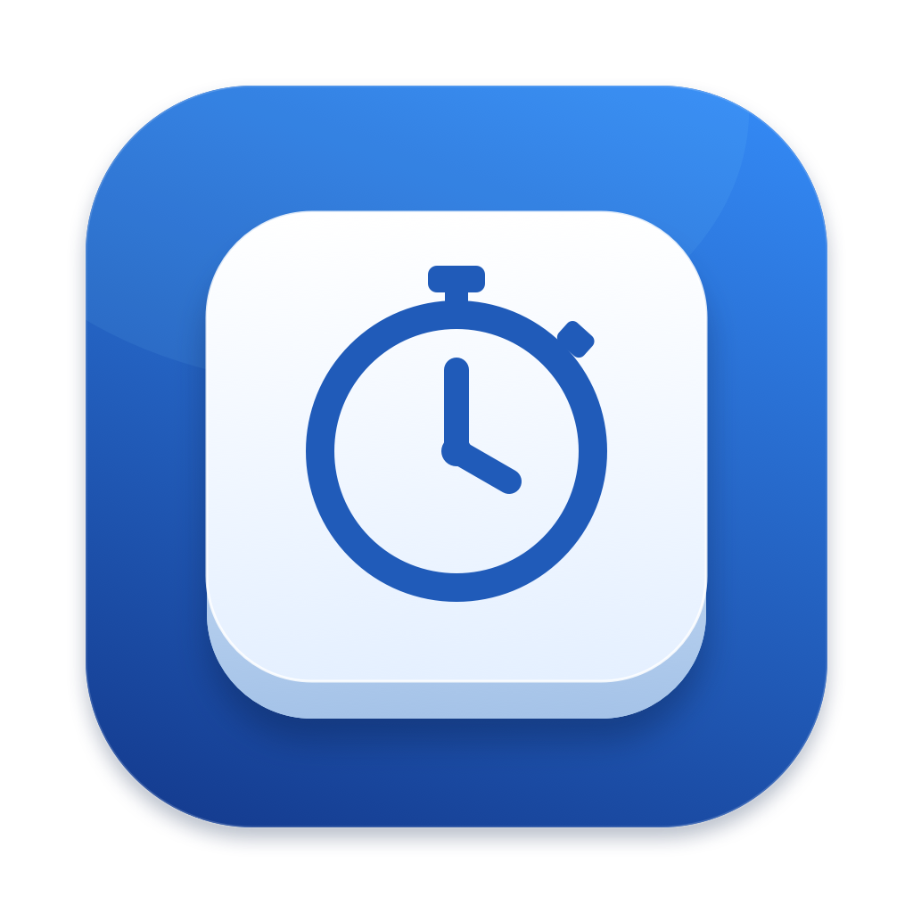

# Keypress



A small, local macOS menu bar stopwatch for measuring the input actions involved in an activity. Swift/AppKit, no dependencies; macOS 13 or newer, built with Swift 6 or newer.

For a related tool on Linux/Wayland, see [wl-actions](https://github.com/kaihendry/wl-actions): a CLI that wraps a Wayland application and counts keyboard, mouse, scroll, and touch activity. The two tools use different counting rules, so their totals are not directly interchangeable.

## Install with Homebrew

```sh
brew install kaihendry/tap/keypress
keypress
```

The [formula](https://github.com/kaihendry/homebrew-tap/blob/main/Formula/keypress.rb) builds from a checksummed source release with Apple's Swift 6+ toolchain and installs `Keypress.app` plus a `keypress` launcher. No `sudo` is needed. The launcher opens the menu bar app; `keypress --version` prints its version and Git revision.

For Finder and Spotlight, optionally link the app into your Applications folder:

```sh
mkdir -p ~/Applications
ln -s "$(brew --prefix kaihendry/tap/keypress)/Keypress.app" ~/Applications/Keypress.app
```

Use `brew upgrade kaihendry/tap/keypress` to update and `brew uninstall kaihendry/tap/keypress` to remove it. Remove the optional Applications link when uninstalling. Choose either Homebrew or the source installation below to avoid having multiple copies with the same name.

## Build and install from source

```sh
git clone https://github.com/kaihendry/keypress.git
cd keypress
make install
open /Applications/Keypress.app
```

`make install` builds the release app, copies it to `/Applications`, and verifies its signature. Quit Keypress before reinstalling, then reopen the installed copy. To install just for your user, run `make install INSTALL_DIR="$HOME/Applications"`. For a build without installation, run `make build`; the app is created at `build/Keypress.app`.

Click the stopwatch in the menu bar to start or stop. Stopping opens the results; right-click opens them at any time. Start again to resume; Reset clears the session. The copy button copies aggregate results. Nothing is saved on disk; quitting clears the session.

On first use, enable **Accessibility** and **Input Monitoring** using the buttons in the panel. Both are required: Accessibility supplies target geometry for Fitts estimates; Input Monitoring supplies input events. In the permission dialog's app picker, select `/Applications/Keypress.app` (or your custom install location). macOS may require quitting and reopening the app after permission changes. Keep the app in the same location; moving or rebuilding an ad-hoc-signed app can require granting permissions again.

For a Homebrew installation, select the linked `~/Applications/Keypress.app`, or press **⌘⇧G** in the picker and enter the path printed by `brew --prefix kaihendry/tap/keypress`, then select `Keypress.app`.

## Restarting and checking the version

**Updates do not restart the app automatically.** Right-click the stopwatch, copy any results you want to keep, and choose **Quit**. Then run `keypress` for Homebrew, or `open /Applications/Keypress.app` for a source install. Restarting clears the session totals. The app also does not automatically start at login.

For source installs, `make restart` quits the running app and opens the installed copy. It does not rebuild it; use `make install` first after changing the source.

The bottom of the panel displays the running version and Git revision, for example `v0.1.0 · git abc123def456`. A `-dirty` suffix means the build included local changes. The displayed version is captured when the app launches; installing a new build does not change an older process's displayed version. If the panel still shows old wording, quit and reopen the app.

## What counts

| Input | One action |
| --- | --- |
| Keyboard | One non-repeating key-down. ⌘C, ⇧⌘S, and a typed letter each count as one. Modifier presses alone and held-key repeats are excluded. |
| Mouse / trackpad click | One button-down, including tap-to-click. A double click counts as two. Starting a drag counts as a click. |
| Trackpad scrolling | One finger-driven scroll stroke. Momentum after lifting fingers is excluded. |
| Mouse wheel | One burst of wheel events separated from the next by more than 300 ms. A wheel does not expose finger-contact boundaries. |
| Other gestures | Pinch, rotation, swipe, and smart zoom **if delivered by macOS**. These are best-effort observations, not complete system-wide touch tracking. |

Mouse and trackpad input contribute to the same totals. Keypress's own controls are excluded. Monitoring is installed only while the stopwatch runs. Permission loss, sleep, session deactivation, secure keyboard input, or an event-tap interruption pauses the session visibly. Secure input can cause a brief gap before the pause is detected. Resume manually when ready.

macOS public APIs do not provide reliable global raw touch/contact tracking. System gestures such as switching Spaces may be consumed before an app can observe them. A zero under “Other gestures” means none were observed, not necessarily that none occurred. Media keys, modifier-only actions, and software-generated events are not separately classified. These totals describe observed input, not verified physical movements.

## Minimal Fitts estimate

For measurable clicks, the app estimates the nominal Shannon index of difficulty:

```
ID = log2(1 + D / W)   [bits]
```

- **D:** straight-line distance from the pointer's movement origin to the target centre, in screen points. The origin resets after a click/drag or a movement gap longer than 300 ms. This is a heuristic for the beginning of a pointing action.
- **W:** the length of the line through the target's rectangular centre along the direction of approach, clipped to its bounds. For a horizontal approach this is its width; for a vertical approach, its height. Starting inside the target contributes zero.
- **Target:** a supported Accessibility control (button, link, menu item, checkbox, etc.). Labels are walked up to a control, but broad document, text, canvas, or window bounds are not used as substitutes for a target.

The app samples target geometry on a background queue every 150 ms while running. A click is measurable only if the pre-click sample is at most 400 ms old, its sampled point is within 6 screen points of the click, the click remains inside the target, and the foreground app has not changed. This deliberately sacrifices coverage to avoid measuring the content revealed *after* a click dismisses a menu or window. Dynamic interfaces can still invalidate a snapshot. Fast clicks and apps with incomplete Accessibility support often remain unmeasured.

The panel shows **Average pointing difficulty**, with **Lower = easier targets**, and **measured clicks / all clicks**. Hover over the information icon for the technical unit (bits) and example scores. Missing measurements never enter the mean as zero. Results are an approximate pointing-difficulty comparison, not a calibrated movement-time prediction, ISO throughput, or medical strain score. Compare coverage as well as averages across activities; there is no combined weighted “strain” score.

Only aggregate counts and difficulty totals are retained for the session. A current pointer origin and short-lived target geometry are held in memory for measurement. The code does not read key identities, typed text, Accessibility labels, or control values; it stores no event history and makes no network requests.

References: [MacKenzie on Fitts's law](https://www.yorku.ca/mack/hci1992.html), [two-dimensional targets](https://www.yorku.ca/mack/CHI92.html), [Apple event monitoring](https://developer.apple.com/library/archive/documentation/Cocoa/Conceptual/EventOverview/MonitoringEvents/MonitoringEvents.html), [Apple trackpad events](https://developer.apple.com/library/archive/documentation/Cocoa/Conceptual/EventOverview/HandlingTouchEvents/HandlingTouchEvents.html).

## Development and verification

```sh
make test
make build
```

The Swift wrapper uses the selected toolchain and locates the Swift Testing macros in standalone Command Line Tools. If Command Line Tools has mismatched public/private PackageDescription interfaces left over from an upgrade, it uses a project-local copy of the current public interface. It never modifies the installed toolchain. On a consistent installation, plain `swift test` also works.

The original app icon is drawn with AppKit vector shapes in `scripts/generate-icon.swift`. Run `make icon` to regenerate the PNG preview and the complete macOS `.icns` asset. Builds use the checked-in icon, so no image-generation service or extra tool is required.

The tests cover shortcut/repeat semantics, trackpad momentum, wheel bursts, gesture sequences, pause/resume, Fitts geometry and missing-target handling. Real cross-app input requires the permissions above and a manual check:

1. Start, switch to another app, type three letters and press ⌘C: expect four keyboard actions (plus any other shortcuts used to switch apps).
2. Hold a letter: expect one extra action. Click twice: expect two clicks.
3. Scroll a single trackpad stroke and let it coast: expect one scroll. Try the mouse wheel too.
4. Move onto an accessible button, wait briefly, then click. Confirm measured-target coverage increases. Repeat with a smaller/farther target to compare difficulty.
5. Stop: counts and time freeze. Resume retains the totals. Reset returns everything to zero.
6. Try pinch/swipe/rotation in your apps and check which gestures the OS actually exposes. Treat unavailable gestures as missing coverage.

The app is ad-hoc signed for local use, not notarized for distribution.
